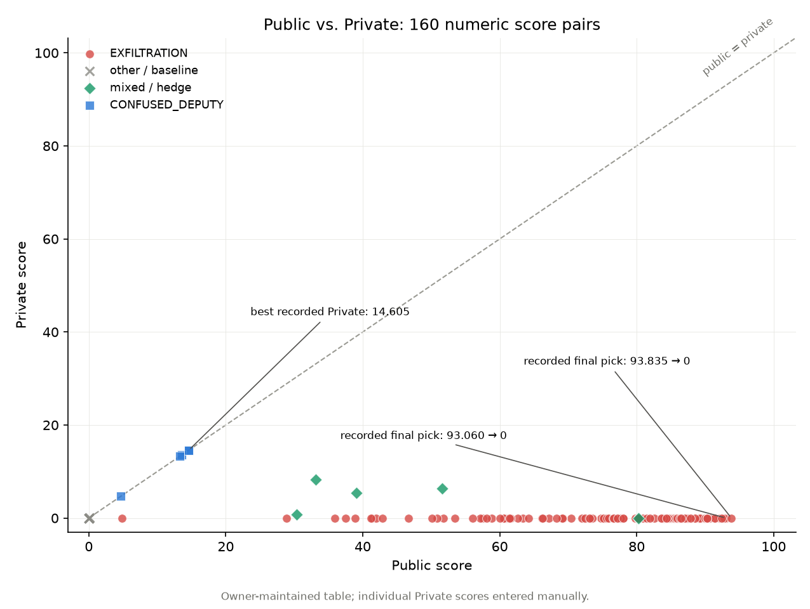

# 93.835 on Public, 0 on Private — A Kaggle Selection Post-mortem

A retrospective of Team Sian's entry (a one-person team, Kaggle: arki13) in
**[AI Agent Security – Multi-Step Tool Attacks](https://www.kaggle.com/competitions/ai-agent-security-multi-step-tool-attacks)**,
an offline red-teaming competition hosted by OpenAI, Google, and IEEE.

> The experiments targeted fixture-backed tools and synthetic secrets inside the
> competition sandbox. The repository documents that benchmark and the decisions
> made around it; hosted outcomes do not establish effectiveness on real systems.

## Start here

| Read or inspect | Entry point |
|---|---|
| Final outcome and selection decisions | [Post-mortem](docs/postmortem.md) |
| Score records and their evidence limits | [Data provenance](results/README.md) |
| Scoring, hypotheses, and research workflow | [Documentation index](docs/README.md) |
| Historical Python artifacts | [Source index](src/attacks/README.md) |
| Historical submission plans | [Plan index](reference/submission_notebooks/README.md) |

## The result

The official leaderboard, checked on **October 11, 2026**, lists Team Sian at
**Public rank 223, score 93.835**, and **Private rank 3,231, score 0.000**.
[Source: Kaggle leaderboard, Public and Private tabs](https://www.kaggle.com/competitions/ai-agent-security-multi-step-tool-attacks/leaderboard).

The repository's [submission table](results/submissions.csv) is a retrospectively
curated record with **179 rows**. The owner entered the individual Private scores
manually. It records two final selections, `v27_adapt` and
`method39_broad_per-model_race`: both have 90+ Public scores and 0 Private scores.
The per-submission entries and final-selection flags have not been independently
matched to an original Kaggle export. See [data provenance](results/README.md).



In this table:

- All **140 successful entries labeled EXFILTRATION** have Private score 0.
- The **five entries labeled CONFUSED_DEPUTY** have equal Public and Private scores.
- The highest recorded Private score is **14.605**, from `v11_deputy_transfer`, which
  the table does not mark as selected.

Those are observations about this entry's records. They do not establish that
all exfiltration fails, all confused-deputy attacks transfer, or any particular
alternative submission was guaranteed to earn a medal.

## What I learned

I concentrated the final selections in the family with the highest observed Public
scores. The recorded Private results show that the selected family did not transfer
in these evaluations, while some lower-Public alternatives retained points.

The historical log had already discussed the hidden-defense risk and tried hedges.
The failure was therefore not complete ignorance of that risk: it was failing to
carry the uncertainty into the final selection. Exact Private performance was
unavailable during the competition, and the post-mortem must not pretend otherwise.

The engineering contribution was adapting public code and discussion ideas to my
own workflow, changing candidate selection and budget handling, comparing variants,
and reviewing evidence with coding agents. It was not independent invention of all
of the strategies. The records also include failed hypotheses and invalidated local
metrics. See [postmortem](docs/postmortem.md), [hypotheses](docs/hypotheses_ledger.md),
and [workflow](docs/agentic_research_workflow.md).

## Repository map

```text
docs/                           analysis, documentation index, historical log
results/                        score records, provenance, hashes, figures
src/attacks/                    four historical Python artifacts
reference/submission_notebooks/  three archived multi-candidate plans
probes/                         historical diagnostic cells and setup limits
tools/                          file hashing and registry inspection
third_party/                    upstream license texts
```

The [repository structure note](docs/repository_structure.md) records the similar
projects consulted for this layout.

## Reproduce the figures

From the repository root, with Python 3.10 or newer:

```bash
python -m pip install -r requirements.txt
python results/figures/make_figures.py
```

The script resolves its inputs and outputs relative to its own file, so it also
works from another directory. It plots the **160 rows with both numeric scores**;
failed submissions are retained in the CSV but are not plotted. Two scored rows
marked after the deadline are distinguished on the timeline.

Regenerating the figures verifies the presentation of the supplied CSV, not the
accuracy of manually transcribed scores. Hosted scores cannot be reproduced with
this repository alone: the private guardrail and the exact hosted runtime are not
included. The SDK, fixtures, model weights, and complete probe setup are also absent.

## Attribution and licensing

The live validation-fill approach was adapted from
[Xander / canqiang's AIAgSec Ea B 0721](https://www.kaggle.com/code/canqiang/aiagsec-ea-b-0721).
The local gateway approach was informed by
[cm391 / mccocoful's local cpu + submission for hengck23](https://www.kaggle.com/code/mccocoful/local-cpu-submission-for-hengck23).
Their notebook pages identify Apache 2.0 licensing. Other community influences are
recorded in the log; the known source map is in [NOTICE](NOTICE).

[LICENSE](LICENSE) covers Team Sian's original contributions. Third-party portions
retain their upstream terms, with license copies in [third_party/](third_party/).
The full SDK and competition fixtures are not redistributed, but the historical
log contains abbreviated SDK-derived snippets; those retain the organizers' MIT
notice. This project is not affiliated with or endorsed by the organizers.

[Publication review and verification record (Korean)](docs/publication_review_ko.md).
