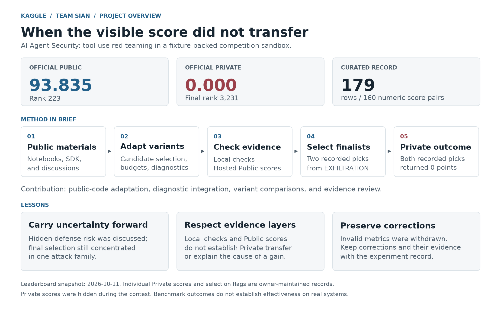
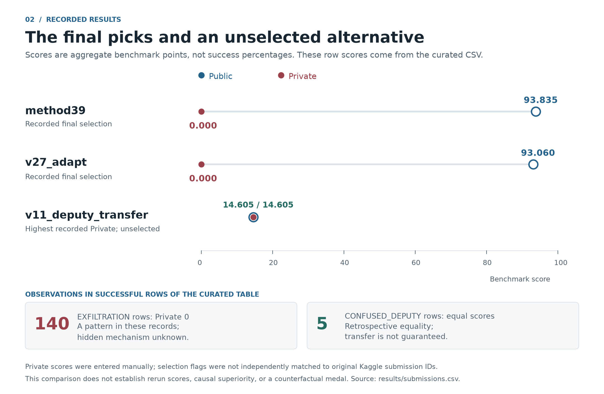
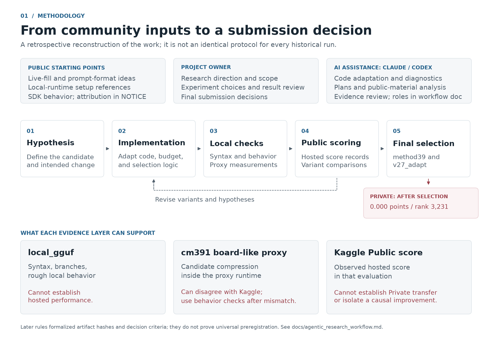
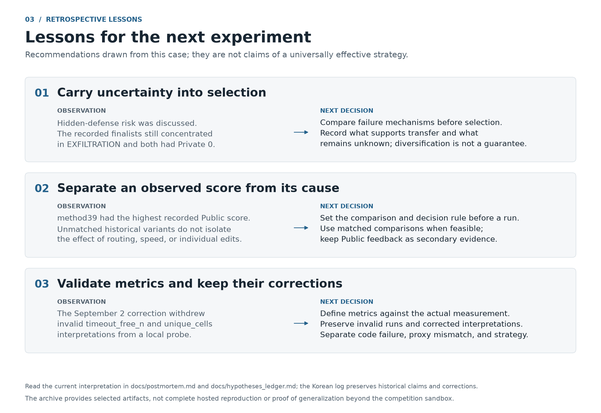

# Public 93.835, Private 0 — Kaggle 최종 제출 선택 회고

[English](README.md) | 한국어

Team Sian이 **[AI Agent Security – Multi-Step Tool Attacks](https://www.kaggle.com/competitions/ai-agent-security-multi-step-tool-attacks)**에
참가하며 수행한 실험과 최종 제출 선택을 돌아보는 프로젝트입니다.
OpenAI, Google, IEEE가 주최한 이 대회는 오프라인 환경에서 AI 에이전트의 보안을 평가하는 레드팀 대회였습니다.

> 실험 대상은 대회 샌드박스 안의 테스트용 도구와 합성 비밀 정보였습니다.
> 이 저장소는 해당 벤치마크와 실험·선택 과정을 기록합니다.
> 대회 결과만으로 실제 시스템에서도 같은 효과가 있다고 판단할 수는 없습니다.



## 어디부터 읽으면 좋을까요?

이 README는 한국어로 제공하며, 상세 분석 문서와 도표는 영어로 작성되어 있습니다.
한국어 실험 기록과 공개 전 검토 기록도 함께 보존했습니다.

| 알고 싶은 내용 | 시작할 문서 |
|---|---|
| 최종 결과와 제출 선택의 이유 | [결과 회고](docs/postmortem.md) |
| 점수 기록의 출처와 확인 가능한 범위 | [데이터 출처](results/README.md) |
| 채점 방식, 실험 가설, 연구 흐름 | [문서 안내](docs/README.md) |
| 주요 코드가 필요한 이유와 실제 동작 | [코드 해설](docs/code_walkthrough.md) |
| AI 활용 중 오류·정정과 앞으로의 확인 사항 | [AI 활용 반성](docs/ai_assistance_reflection_ko.md) |
| 당시 사용한 Python 코드 | [소스 코드 안내](src/attacks/README.md) |
| 당시 작성한 제출 계획 | [제출 계획 안내](reference/submission_notebooks/README.md) |
| 전체 개요, 상세 도표, SVG 파일 | [시각 자료 안내](results/figures/README.md) |

## 결과

**2026년 10월 11일** 확인한 공식 리더보드에서 Team Sian의 결과는
**Public 223위·93.835점**, **Private 3,231위·0.000점**입니다.
[출처: Kaggle 리더보드의 Public·Private 탭](https://www.kaggle.com/competitions/ai-agent-security-multi-step-tool-attacks/leaderboard).

저장소의 [제출 기록](results/submissions.csv)은 대회 이후 정리한 **179개 행**으로 구성되어 있습니다.
개별 제출의 Private 점수는 작성자가 직접 입력했습니다.
기록상 최종 선택은 `v27_adapt`와 `method39_broad_per-model_race`이며,
두 제출 모두 Public은 90점 이상, Private은 0점입니다.
개별 제출 기록과 최종 선택 표시는 원본 Kaggle 내보내기 자료와 독립적으로 대조하지 못했습니다.
자세한 범위는 [데이터 출처](results/README.md)를 참고하세요.



이 기록에서 확인한 결과는 다음과 같습니다.

- **EXFILTRATION으로 분류된 성공 제출 140개**의 Private 점수는 모두 0입니다.
- **CONFUSED_DEPUTY로 분류된 5개 제출**의 Public·Private 점수는 서로 같습니다.
- 기록된 최고 Private 점수는 `v11_deputy_transfer`의 **14.605점**이며, 최종 선택으로 표시되어 있지 않습니다.

이는 이 프로젝트의 제출 기록에서 관찰한 결과입니다.
모든 정보 유출 공격이 실패한다거나, 모든 confused-deputy 공격이 다른 평가 환경에서도 통한다거나,
특정 대안을 제출했다면 반드시 메달을 받았을 것이라는 뜻은 아닙니다.

## 무엇을 배웠나

최종 제출을 고를 때 가장 높은 Public 점수를 보인 계열에 선택을 집중했습니다.
기록된 Private 결과에서는 선택한 계열이 성과를 유지하지 못했고,
Public 점수가 더 낮았던 일부 대안은 점수를 유지했습니다.

당시 실험 기록에서도 비공개 방어 장치의 위험을 논의하고 대안을 시도했습니다.
따라서 핵심 실패는 위험을 전혀 몰랐던 것이 아니라,
그 불확실성을 최종 제출 선택에 충분히 반영하지 못한 데 있습니다.
대회 중에는 정확한 Private 성능을 알 수 없었으며, 이 회고도 당시 그 결과를 알고 있었던 것처럼 설명하지 않습니다.

실패한 가설과 타당하지 않아 폐기한 로컬 지표도 기록에 포함되어 있습니다.
[결과 회고](docs/postmortem.md)와 [가설 기록](docs/hypotheses_ledger.md)에서 확인할 수 있습니다.

AI 활용 과정에서 방향·측정·구현·기록이 어긋난 사례는
[AI 활용 반성문](docs/ai_assistance_reflection_ko.md)에 정리했습니다.
38개 검토 항목을 원문·정정·재발 방지 기준과 연결하고, 직접적인 AI 출력 오류와
원인이 불분명한 공동 작업의 실패를 구분합니다.

## 기여와 AI 활용

공개 코드와 discussion의 아이디어를 코딩 에이전트의 도움으로 수정·통합했습니다.
프로젝트 작업에는 후보 선택·시간 예산의 변형, 진단 코드 통합, 비교 실험과 근거 검토가 포함됩니다.

| 참여자 또는 자료 출처 | 이 프로젝트에서 맡은 역할 |
|---|---|
| 프로젝트 작성자(Team Sian) | 작업 방향 설정, 실험 변경 사항 선택, 결과 검토, 최종 제출 결정 |
| Claude / Codex | 코드 수정·통합, 진단 코드, 제출 계획, 공개 자료 분석, 근거 검토 지원 |
| 공개 노트북과 discussion | 출발점이 된 주요 아이디어·코드·실행 환경 참고 자료 제공. 저자와 라이선스는 [NOTICE](NOTICE)에 명시 |

기록에 남은 Claude·Codex의 업무 배정과 그 범위는
[연구 흐름 문서](docs/agentic_research_workflow.md#contributions-and-decision-ownership)에 설명했습니다.
현재 기록만으로 AI가 작성한 코드의 비율이나 대회 전체에 걸친 고정 역할을 산정할 수는 없습니다.
모든 전략을 독자적으로 고안했다고 주장하지 않습니다.

## 연구 흐름



이 도표는 대회 이후 기록을 바탕으로 재구성한 흐름입니다.
후반에 정리한 파일 추적·의사결정 규칙만으로 모든 초기 실험이 동일한 절차를 따랐거나,
완전한 사전 등록을 갖추었다고 볼 수는 없습니다.
[연구 흐름과 근거의 한계](docs/agentic_research_workflow.md)를 함께 참고하세요.

## 대표 코드 이해하기

네 구현은 후보를 반환하기 전에 얼마나 시험할지에 대해 서로 다른 선택을 합니다.
[코드 해설](docs/code_walkthrough.md)은 각 구현의 목적, 실행 흐름, 예외 시 동작,
기록된 결과와의 관계를 설명합니다.

| 구현 | 후보를 만드는 동안 하는 일 |
|---|---|
| `v3_livefill` | 각 메시지를 시험하고, 추정 시간 한도 안에서 trace 확인을 통과한 후보를 유지 |
| `method21` | 네 계열을 소규모로 시험한 뒤, 선정한 한 계열로 추가 검증 없이 후보 묶음을 생성 |
| `method39` | 전달받은 환경에서 다섯 형식 변형을 소규모로 시험한 뒤, 추가 검증 없이 후보 묶음을 생성 |
| `method44` | 후보마다 네 가지 동작을 의도한 단일 메시지를 넣어 고정된 묶음을 생성 |

후보를 반환하는 것과 그 후보를 재실행(replay)해 채점하는 것은 별도 단계입니다.
예상한 도구 이벤트가 trace에 나타나는 것과 실제 채점 조건을 충족하거나 새로운 cell로 인정받는 것도 다릅니다.
함수·상수의 세부 내용과 보조 진단 코드·해시 도구는 [코드 참조](docs/code_reference.md)에 정리했습니다.

## 다음 실험에 적용할 교훈



이 교훈은 이번 사례에서 도출한 제안입니다.
특정 대안이 메달을 받았을 것이라거나, 어느 공격 계열이든 다른 평가 환경에서도 항상 통한다는 근거는 아닙니다.
[결과 회고](docs/postmortem.md)와 [가설 기록](docs/hypotheses_ledger.md)에 판단 근거를 정리했습니다.

## 저장소 구성

```text
docs/                           분석 문서, 문서 안내, 당시 실험 기록
results/                        점수 기록, 출처, 해시, 시각 자료
src/attacks/                    당시 사용한 대표 Python 코드 4개
reference/submission_notebooks/  보존한 다중 후보 제출 계획 3개
probes/                         당시 진단 코드와 실행 환경의 제약
tools/                          파일 해시 계산과 제출 레지스트리 확인
third_party/                    원본 라이선스 사본
```

구성에 참고한 유사 프로젝트는 [저장소 구조 설명](docs/repository_structure.md)에 기록했습니다.

## 시각 자료 다시 만들기

Python 3.10 이상 환경에서 저장소 루트를 기준으로 실행하세요.

```bash
python -m pip install -r requirements.txt
python results/figures/make_figures.py
python results/figures/make_project_visuals.py
```

두 스크립트는 자신의 파일 위치를 기준으로 입력·출력 경로를 찾으므로 다른 디렉터리에서도 실행할 수 있습니다.
점수 그래프는 **Public·Private 점수가 모두 숫자인 160개 행**을 사용합니다.
실패한 제출도 CSV에 보존하지만 그래프에는 표시하지 않습니다.
마감 이후로 표시된 채점 완료 제출 2개는 시간순 그래프에서 구분합니다.

프로젝트 개요 도표 생성 스크립트는 네 도표를 PNG와 SVG로 저장합니다.
내용의 출처와 해석 범위는 [시각 자료 안내](results/figures/README.md)에 정리했습니다.

도표를 다시 생성하면 제공된 CSV의 시각화를 재현할 수 있지만, 수기로 옮긴 점수의 정확성까지 검증하지는 못합니다.
이 저장소만으로 대회 점수를 재현할 수도 없습니다.
비공개 방어 장치와 당시의 정확한 대회 실행 환경이 포함되어 있지 않으며,
SDK, 테스트용 fixtures, 모델 가중치, 진단 코드의 전체 실행 환경도 포함되어 있지 않습니다.

## 출처와 라이선스

실행 중 검증하며 후보를 채우는 접근은
[Xander / canqiang의 AIAgSec Ea B 0721](https://www.kaggle.com/code/canqiang/aiagsec-ea-b-0721)을 수정해 사용했습니다.
로컬 게이트웨이 접근은
[cm391 / mccocoful의 local cpu + submission for hengck23](https://www.kaggle.com/code/mccocoful/local-cpu-submission-for-hengck23)을 참고했습니다.
두 노트북 페이지에는 Apache 2.0 라이선스가 명시되어 있습니다.
그 외 커뮤니티 자료의 영향은 실험 기록에 남겼으며, 확인한 출처 관계는 [NOTICE](NOTICE)에 정리했습니다.

[LICENSE](LICENSE)는 Team Sian이 직접 작성한 부분에 적용됩니다.
외부 코드에서 가져온 부분에는 원본 라이선스 조건을 유지하며, 사본을 [third_party/](third_party/)에 보관했습니다.
전체 SDK와 대회 fixtures는 재배포하지 않습니다.
다만 당시 실험 기록에는 SDK에서 발췌·축약한 코드가 포함되어 있어 주최 측의 MIT 고지를 유지했습니다.
이 프로젝트는 주최 기관과 제휴 관계가 없으며, 해당 기관의 공식 승인을 받은 프로젝트도 아닙니다.

[공개 전 검토 및 확인 기록](docs/publication_review_ko.md).
