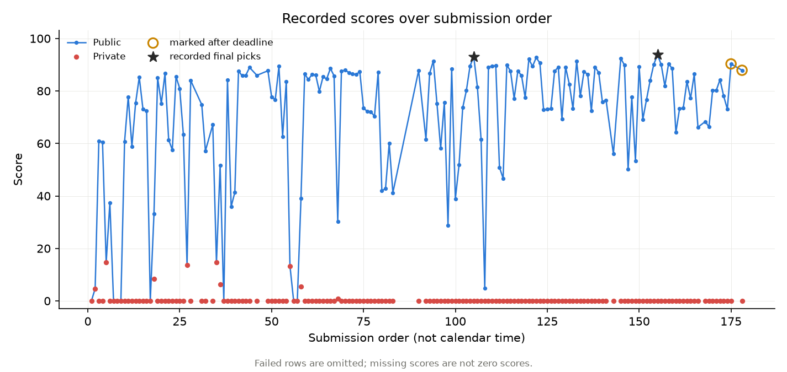

# Post-mortem: selecting for a visible metric under a hidden defense

The official leaderboard lists Team Sian at **Public 93.835 / rank 223** and
**Private 0.000 / rank 3,231**, checked on October 11, 2026.
[Official leaderboard](https://www.kaggle.com/competitions/ai-agent-security-multi-step-tool-attacks/leaderboard).
Individual submission results below come from the owner-maintained
[CSV](../results/submissions.csv), whose Private scores were entered manually.
[Provenance and limitations](../results/README.md).

## The benchmark

The competition replayed submitted candidates against tool-using models and
fixture-backed tools. Security predicates rewarded successful actions such as
EXFILTRATION and CONFUSED_DEPUTY. Public and Private evaluation used different
guardrails; the Private result determined final standing.

The packaged public guardrail's source shows a first-field check: with `url` and
`data` both present, it examines `url` first. That is an inspectable property of the
packaged SDK, not direct evidence of the hidden guardrail's implementation.

## What the recorded results show

The Public maximum in the CSV is **93.835**. The table marks `v27_adapt` (93.060)
and `method39_broad_per-model_race` (93.835) as the two final selections. Both have
Private score 0. Their selection flags are retrospective records, not independently
verified submission IDs.

Among the successful rows, all 140 labeled EXFILTRATION have Private score 0.
The five labeled CONFUSED_DEPUTY have matching Public and Private scores. Several
mixed entries also retain some Private points. Family labels summarize intended
candidate composition; they are not per-model trace annotations.

| Submission | Recorded Public | Recorded Private |
|---|---:|---:|
| `v11_deputy_transfer` | 14.605 | 14.605 |
| `deputy_hedge` | 14.590 | 14.590 |
| `v8_deputy_modern` | 13.585 | 13.585 |
| `v16_deputy` | 13.305 | 13.305 |

The best unselected recorded Private score is 14.605. That supports the narrower
counterfactual that selecting this already-evaluated entry would have retained more
recorded points than the two selected entries. It does not establish a precise
counterfactual rank, medal, guaranteed rerun score, or a 30-point gold opportunity.
Medal cutoffs and counts of zero-score teams are omitted because their source
snapshots and calculation are not bundled.

## What was known at the time

Private scores were hidden during the contest. The log nevertheless discussed
Public–Private differences on August 1 and August 15 and explored deputy and mixed
hedges. Therefore the story is not that nobody asked whether the Public score would
transfer. The risk was recognized, but the final recorded selections concentrated
on Public-performing exfiltration entries.

The equality of the deputy rows became visible retrospectively. Saying “I knew in
July that these transferred perfectly” would turn hindsight into prior evidence.
Likewise, a normal-looking email can be blocked by a defense; the table cannot prove
that such actions are inherently unblockable.

## Engineering and measurement

Public notebooks and discussions informed the live-fill, prompt-format, and local
runtime approaches. My work adapted them, integrated diagnostics, compared budget
and candidate-selection variants, and managed the experiment records with coding
agents. [Attribution](../NOTICE).

The packaged score formula is inspectable, but `0.09 × N` is conditional on one
severity-5 finding and one new score cell per candidate. Aggregate scores cannot
separate replay count, firing rate, cell novelty, or model contributions. The
historical analyses sometimes treated a throughput explanation too confidently.
The log also preserves a September 2 correction withdrawing invalid local
`timeout_free_n` and `unique_cells` interpretations. It would be inaccurate to call
all measurement sound or every experiment independently pre-registered.

## What I would change

1. Carry hidden-defense uncertainty into final selection, even when it cannot be
   measured directly. Keep a candidate from a different mechanism when its recorded
   behavior justifies diversification; do not assume it is guaranteed to transfer.
2. Define comparison and decision criteria before a run, and preserve invalidated
   measurements with their corrections. Distinguish code failure, proxy mismatch,
   and strategy failure.
3. Treat small Public-score differences and inferred replay counts cautiously.
   Without matched comparisons or traces, they do not establish the cause of a gain.

This is a case record of benchmark-specific selection and evidence handling, not a
proof that one attack family or one coding-agent workflow generalizes.
